<div align="center">



### Share files that delete themselves.

<p>
  <a href="https://dropportal.vercel.app"></a>
  
</p>

[**What is it?**](#what-is-it) •
[**Try it**](#try-it) •
[**Run locally**](#run-locally) •
[**Contributing**](#contributing)

</div>

---

<div align="center">
<a id="what-is-it"></a>

</div>

**DropPortal** is a web app for sharing files that delete themselves.

1. **Drop** a file in.
2. **Share** it.
3. **Poof.** It deletes itself.

No clutter left behind: share it, and let it disappear.

---

<div align="center">
<a id="try-it"></a>


<br/>

<a href="https://dropportal.vercel.app"></a>
</div>

---

<div align="center">
<a id="run-locally"></a>

</div>

```bash
git clone https://github.com/AkkhileshCod3s/drop-portal.git
cd drop-portal

# install dependencies and start the dev server
# (check the "scripts" section of package.json for the exact commands)
```

<!-- TODO: add tech stack, environment variables and deployment notes here -->

---

<div align="center">
<a id="contributing"></a>

</div>

Found a bug or have an idea? Contributions are welcome.

1. **Fork** the repo
2. Create a branch: `git checkout -b feature/my-idea`
3. Make your change and run it locally
4. Commit, push and open a **pull request**

---

<div align="center">


Made by [@AkkhileshCod3s](https://github.com/AkkhileshCod3s)
</div>
